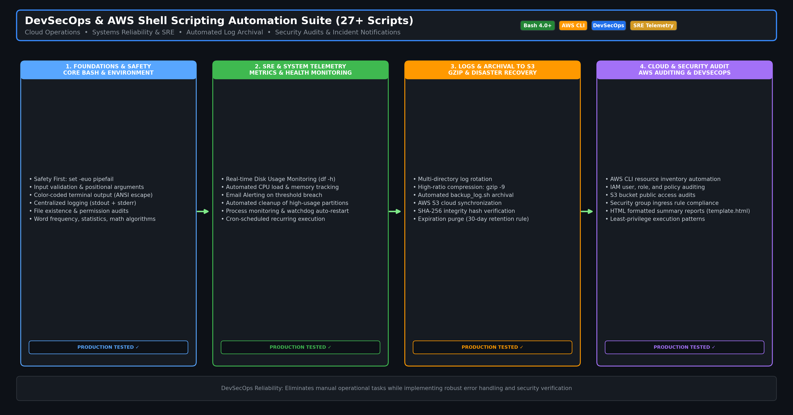

# 📜 DevSecOps & AWS Shell Scripting Automation Suite

<div align="center">

[](https://www.gnu.org/software/bash/)
[](https://aws.amazon.com/cli/)
[](https://www.linux.org/)
[](https://owasp.org/)
[](LICENSE)

**A Production-Minded Collection of 27+ Shell Automation Scripts for Systems Engineering, SRE Telemetry, Log Archival, and Cloud Operations**

---

</div>

## 📌 Executive Summary

Shell scripting remains the foundational glue of infrastructure engineering, cloud operations, and automated DevSecOps pipelines. This repository contains **27+ production-grade Bash scripts** developed to automate common operational tasks, enforce defensive coding patterns, and implement proactive system observability.

**Core Principles Enforced:**
- 🛡️ **Defensive Bash**: Every script uses strict error handling (`set -euo pipefail`), input validation, and proper exit codes.
- 📊 **SRE Telemetry**: Proactive monitoring of disk capacity, memory exhaustion, CPU loads, and service health with email alerting.
- 📦 **Automated Archival**: Automated log rotation, `gzip -9` compression, SHA-256 integrity checks, and cloud sync to AWS S3.
- 🔐 **Security Baseline**: Non-root execution enforcement, quoted here-docs, safe variable interpolation, and permission checks.

---

## 🏛 Architecture & Workflow



---

## 🗂️ Script Catalog & Functional Index

### 1. SRE, Monitoring & Disaster Recovery
| Script | Description | Key Techniques & Tools |
| :--- | :--- | :--- |
| **[`24-backup_log.sh`](24-backup_log.sh)** | Gzip log rotation, timestamped archival, and retention policy purge | `gzip -9`, `tar`, `find -mtime`, automated cleanup |
| **[`25-disk-usage.sh`](25-disk-usage.sh)** | Filesystem capacity scanner with warning & critical thresholds | `df -h`, `awk`, threshold comparison, color-coded output |
| **[`26-cpu_usage.sh`](26-cpu_usage.sh)** | Real-time CPU load and memory utilization tracker | `/proc/loadavg`, `top -bn1`, `free -m` |
| **[`27-disk-usage-mail.sh`](27-disk-usage-mail.sh)** | Automated disk alert engine with email notification dispatch | `mailx` / `sendmail`, HTML templating, threshold gates |
| **[`alert.sh`](alert.sh)** | Alert dispatcher with customizable warning thresholds | Exit code signals, console logging |

### 2. Systems Administration & Configuration Engineering
| Script | Description | Key Techniques & Tools |
| :--- | :--- | :--- |
| **[`08-installation.sh`](08-installation.sh)** | Automated multi-package installer with root privilege verification | `yum` / `dnf`, root UID check (`$EUID -ne 0`) |
| **[`11-logs.sh`](11-logs.sh)** | Dual-stream logging framework capturing stdout and stderr | Redirection (`>&`), timestamped prefixes, log levels |
| **[`12.File_Existence_&_Permissionsions.sh`](12.File_Existence_&_Permissionsions.sh)** | File existence, symlink integrity, and permission auditing | `test -f`, `test -r`, `test -w`, `test -x`, octal permissions |
| **[`14-replace_foo_in_configs.sh`](14-replace_foo_in_configs.sh)** | Batch in-place configuration file parameter replacement | `sed -i`, regex pattern matching, backup creation |
| **[`15-filter_errors.sh`](15-filter_errors.sh)** | Log file error extraction and incident severity filtering | `grep -E`, `awk`, error rate aggregation |
| **[`16-find_largest.sh`](16-find_largest.sh)** | Top disk space consumers scanner across directories | `du -ah`, `sort -rh`, `head -n 10` |
| **[`setup.sh`](setup.sh)** | Automated system bootstrap and toolchain environment provisioner | Idempotent package setup, path configuration |

### 3. Security, Algorithms & Text Processing
| Script | Description | Key Techniques & Tools |
| :--- | :--- | :--- |
| **[`02-safety_test.sh`](02-safety_test.sh)** | Demonstrates error trapping and fail-safe execution | `set -e`, `trap '...' ERR`, signal handling |
| **[`10-color.sh`](10-color.sh)** | ANSI escape sequences for standardized CLI status reporting | Green/Yellow/Red terminal formatting |
| **[`13.count_file_stats.sh`](13.count_file_stats.sh)** | Directory statistics (total files, directories, size aggregation) | `find`, `wc -l`, pipe streaming |
| **[`17-generate_password.sh`](17-generate_password.sh)** | Cryptographically secure random password generator | `/dev/urandom`, `tr`, `fold`, `head -c` |
| **[`18-word_freq_top5.sh`](18-word_freq_top5.sh)** | Text frequency analysis algorithm | `tr`, `sort`, `uniq -c`, pipeline aggregation |
| **[`19-fibonacci.sh`](19-fibonacci.sh)** to **[`23-pyramid.sh`](23-pyramid.sh)** | Algorithmic logic demonstrations in pure Bash | Recursion, loops, arithmetic expansion |

---

## 🚀 Quickstart & Usage

```bash
# Clone the repository
git clone https://github.com/Hemanth26080/shell_scripting.git
cd shell_scripting

# Make all scripts executable
chmod +x *.sh

# Run disk usage health check
./25-disk-usage.sh

# Run log archival script
./24-backup_log.sh /var/log/myapp /var/log/archive 30
```

---

## 🛡️ SRE & DevSecOps Best Practices
- **No Hardcoded Credentials**: API tokens and credentials are passed via environment variables or secret vaults.
- **Fail-Fast Error Handling**: All critical scripts use `set -euo pipefail` to ensure errors are caught immediately instead of cascading.
- **Idempotency**: Execution multiple times preserves consistency without creating duplicate artifacts or state corruption.
